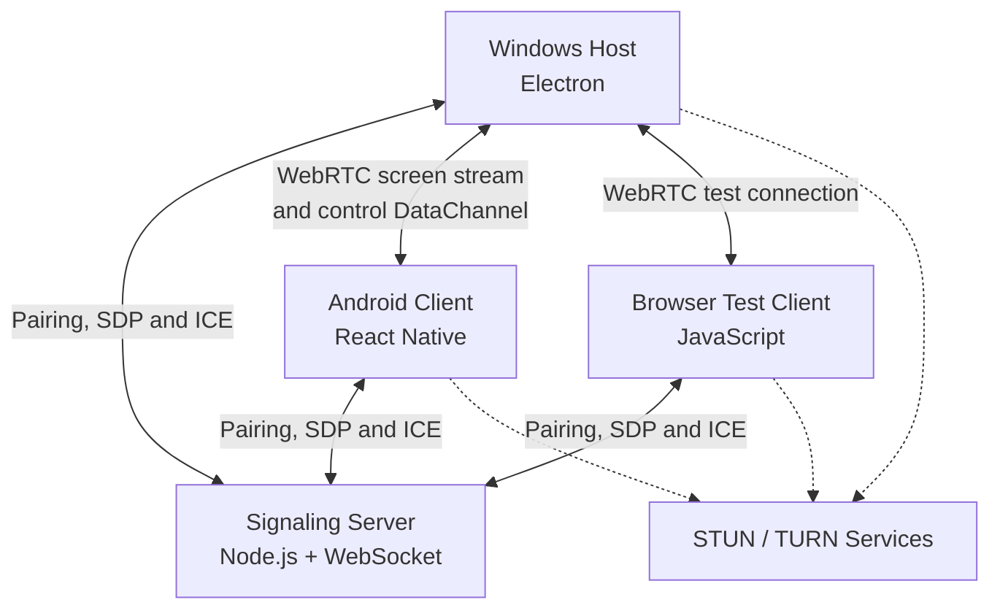

# NexaDesk

**Control your Windows PC remotely from your Android phone.**

NexaDesk is a real-time remote desktop system built with Electron, React Native, Node.js and WebRTC. It allows users to view and control a Windows desktop from an Android device using touch gestures and keyboard input.

The project consists of a Windows Host application, an Android Client, a Browser Test Client and a WebSocket Signaling Server.

The signaling server pairs devices and exchanges WebRTC connection information. Screen streaming and remote-control data use a WebRTC connection, either directly between devices or through a TURN relay when required.

---

## Features

### Remote Desktop
- Real-time Windows screen streaming.
- WebRTC-based communication.
- Automatic six-character pairing codes.
- Cross-network connectivity using STUN and TURN.

### Remote Control
- Trackpad-style mouse movement.
- Left click, double click and right click.
- Drag and drop.
- Two-finger scrolling.
- Remote keyboard input.
- Ctrl, Alt and Shift shortcuts.
- Resolution-independent mouse coordinates.

### Connectivity and Security
- WebSocket-based signaling.
- Dynamic ICE server configuration.
- Metered TURN relay integration.
- TURN credentials fetched by the signaling server.
- Pairing-code expiration.
- Failed-attempt rate limiting.
- WebSocket heartbeat checks.
- 64 KB signaling message limit.

---

## Repository Structure

This repository uses a monorepo architecture to maintain all NexaDesk components in one place.

```text
Nexadesk/
│
├── apps/
│   │
│   ├── windows-host/
│   │   ├── src/
│   │   ├── package.json
│   │   └── README.md
│   │
│   ├── android-client/
│   │   ├── android/
│   │   ├── ios/
│   │   ├── App.tsx
│   │   ├── package.json
│   │   └── README.md
│   │
│   └── browser-test-client/
│       ├── client.js
│       ├── index.html
│       └── README.md
│
├── services/
│   │
│   └── signaling-server/
│       ├── server.js
│       ├── package.json
│       └── README.md
│
└── README.md
```

### Components

| Component | Description | Technology |
|---|---|---|
| Windows Host | Captures and streams the Windows desktop | Electron, Node.js |
| Android Client | Displays the screen and provides remote controls | React Native, TypeScript |
| Browser Test Client | Tests WebRTC connections from a browser | HTML, JavaScript |
| Signaling Server | Pairs devices and exchanges connection information | Node.js, WebSocket |

---

## Architecture



### Connection Flow

1. Windows Host connects to the signaling server.
2. The server generates a six-character pairing code.
3. Android Client enters the pairing code.
4. The signaling server pairs both devices.
5. The server supplies the ICE server configuration.
6. Host and Client exchange SDP offers, answers and ICE candidates.
7. WebRTC establishes the connection using the available network path.
8. Windows Host streams the desktop.
9. Android Client sends mouse and keyboard commands through a WebRTC DataChannel.

The signaling server handles connection setup. It does not carry the desktop video stream itself.

---

## Technology Stack

| Area | Technologies |
|---|---|
| Desktop application | Electron, Node.js |
| Mobile application | React Native, TypeScript |
| Screen capture | Electron desktop capture |
| Remote input | @nut-tree-fork/nut-js |
| Real-time communication | WebRTC |
| Signaling | Node.js, WebSocket |
| NAT traversal | STUN, TURN |
| TURN provider | Metered |
| Desktop packaging | electron-builder |
| Android packaging | Gradle |
| Backend deployment | Render |

---

## Getting Started

### Prerequisites

- Windows 10 or Windows 11 for the Host.
- Node.js 22.11 or newer for working across the project components.
- npm.
- Android Studio and Android SDK for Android development.
- Git.

### 1. Clone the repository

```bash
git clone https://github.com/kavyakansagara933-cloud/Nexadesk.git
```

```bash
cd Nexadesk
```

### 2. Run Windows Host

Open a terminal:

```bash
cd apps/windows-host
```

Install dependencies:

```bash
npm install
```

Start the Host:

```bash
npm start
```

Build the Windows installer:

```bash
npm run dist
```

The installer is generated inside:

```text
apps/windows-host/dist/
```

### 3. Run Android Client

Open a terminal:

```bash
cd apps/android-client
```

Install dependencies:

```bash
npm install
```

Start Metro:

```bash
npm start
```

To run the Android application during development, use another terminal:

```bash
npm run android
```

To build the release APK:

```powershell
cd android
.\gradlew.bat assembleRelease
```

The APK is generated at:

```text
apps/android-client/android/app/build/outputs/apk/release/app-release.apk
```

### 4. Run Signaling Server

Open a terminal:

```bash
cd services/signaling-server
```

Install dependencies:

```bash
npm install
```

Start the server:

```bash
npm start
```

The server listens on the port provided by the `PORT` environment variable, or port 8080 by default.

### 5. Run Browser Test Client

Navigate to:

```text
apps/browser-test-client/
```

Open `index.html` in a modern web browser.

The Browser Test Client does not require a build step or external npm dependencies.

---

## STUN and TURN Integration

NexaDesk supports direct WebRTC connections and TURN-relayed connections.

### STUN

STUN helps WebRTC discover network addresses and establish direct connections where possible.

### TURN

TURN provides a relay path when a direct peer-to-peer connection cannot be established.

NexaDesk uses Metered as its TURN service provider.

### How TURN Configuration Works

The signaling server fetches ICE server credentials from Metered and supplies the ICE configuration to the Host and Android Client when they pair.

The Metered API key remains on the signaling server and must never be embedded in the desktop application, Android application or public source code.

### Render Environment Variables

Configure the following variables in the signaling server's Render environment:

| Variable | Description |
|---|---|
| `METERED_APP_NAME` | Metered application name |
| `METERED_API_KEY` | Credential-specific Metered API key |
| `PORT` | Server listening port, supplied by Render |

Example:

```text
METERED_APP_NAME=nexadesk
METERED_API_KEY=YOUR_PRIVATE_METERED_API_KEY
```

**Never commit your actual Metered API key to GitHub.**

### Deploying the Server from This Monorepo

When configuring Render to deploy directly from this repository:

- Repository: `Nexadesk`
- Root Directory: `services/signaling-server`
- Build Command: `npm install`
- Start Command: `npm start`

Add the required environment variables in Render.

---

## TURN Relay Testing

Both the Windows Host and Android Client contain a testing option:

```javascript
const FORCE_RELAY = false;
```

For normal operation, keep this setting `false`.

For a forced TURN test:

1. Set `FORCE_RELAY = true` in both applications.
2. Rebuild and run both applications.
3. Connect the Android device to the Windows Host.
4. Verify that streaming and remote controls work.
5. Restore `FORCE_RELAY = false` after testing.

A successful forced-relay connection verifies that the TURN relay path is usable.

---

## Current Limitations

- Windows Host currently supports Windows desktops.
- Screen capture currently targets the primary display.
- Audio streaming is not implemented.
- Clipboard synchronization is not implemented.
- File transfer is not implemented.
- The Browser Test Client is intended for connection testing rather than replacing the Android application.

---

## Releases and Downloads

Download the published applications from the GitHub Releases page:

**[NexaDesk Releases](https://github.com/kavyakansagara933-cloud/Nexadesk/releases)**

Current published release: **v1.0.0**

Available downloads:
- Windows Host installer (`.exe`)
- Android application (`.apk`)

---

## Development and Git History

NexaDesk originally maintained its components in separate repositories.

The project was consolidated into a monorepo using Git subtree imports without squashing, preserving the original component commit histories.

The original standalone repositories have been retained.

---

## Author

**Kavya Kansagara**

Computer Science and Engineering

- GitHub: [@kavyakansagara933-cloud](https://github.com/kavyakansagara933-cloud)
- LinkedIn: [Kavya Kansagara](https://www.linkedin.com/in/kavya-kansagara-32a624335/)

---

**NexaDesk — Remote desktop connectivity across networks.**
