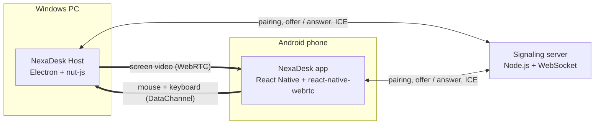
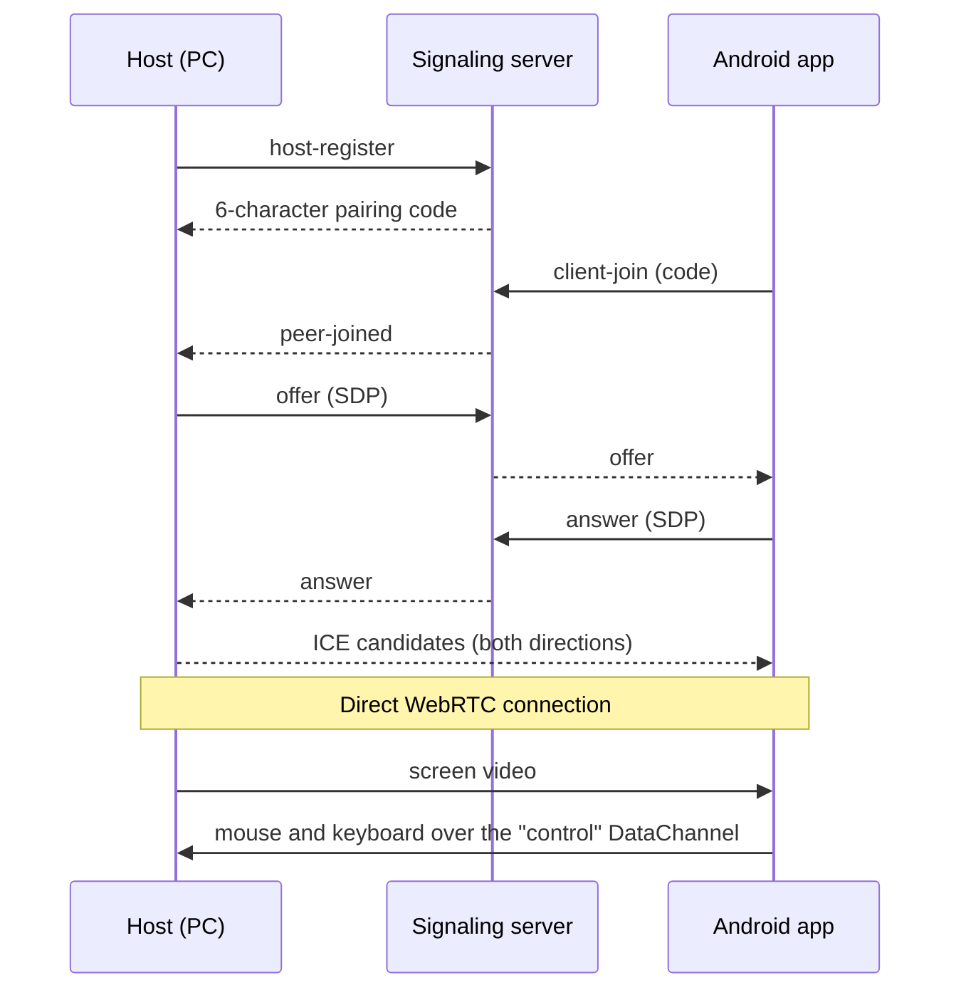

# NexaDesk

**Control your Windows PC from your Android phone, from across the room or across the world.**

NexaDesk is a remote desktop system I built from scratch: a Windows host app that streams your screen, an Android app that shows it and controls it by touch and keyboard, and a small signaling server that pairs the two. The screen video and the control commands travel directly between the devices over WebRTC.

<!-- Replace with your demo GIF or video link -->
<!--  -->

## Features

- **Live screen streaming** from a Windows PC to a phone, over WebRTC
- **Trackpad-style touch control**: drag to move, tap to click, double-tap, tap-and-drag, two-finger tap to right-click, two-finger drag to scroll
- **Full keyboard from the phone**: type text, plus a key bar with Esc, Tab, arrows, Delete and sticky Ctrl / Alt / Shift for shortcuts such as Ctrl+C
- **Pairing by a 6-character code**: no accounts, no port forwarding
- **Resolution-independent input**: positions are sent as fractions of the screen, so the stream can be resized freely
- **Low-latency tuning**: latest-wins command queue, frame-synced mouse events, capped bitrate for mobile Wi-Fi

## Architecture

The signaling server only introduces the two devices. Once they are connected, screen video and control commands flow directly between them.

### Connection flow

## Tech stack

| Part | Technology |
|---|---|
| Host app | Electron, Node.js, `desktopCapturer`, `@nut-tree-fork/nut-js` |
| Android app | React Native (TypeScript), `react-native-webrtc` |
| Signaling | Node.js, `ws` (WebSocket), deployed on Render |
| Transport | WebRTC: video track + ordered DataChannel, STUN |
| Packaging | electron-builder (Windows installer), Gradle (APK) |

## Engineering notes

Problems I ran into while building this, and how I solved them:

- **The cursor wandered instead of following the finger.** nut-js animates `mouse.move`, so many fast moves started overlapping animations. Switching to instant `setPosition` fixed it.
- **Remote control lagged badly.** Several causes, fixed one by one: Chromium throttled the host window when other apps covered it (disabled background throttling); every move was sent individually (now one per animation frame); a backlog of old moves delayed new ones (a command queue that keeps only the latest move).
- **The phone's picture fell behind over time.** The encoder kept raising its bitrate until the Wi-Fi link was full. Capping bitrate, frame rate and size keeps the stream real-time.
- **Mouse accuracy depended on resolution.** Positions are now sent as 0 to 1 fractions and converted on the host, so resizing the video or Windows display scaling can't break pointing.
- **Typing was slow and lossy.** The input library paused 300 ms after every key, and clearing the phone's text box after each key could drop fast keystrokes. The pause was shortened, and the phone now sends exact text differences.

## Getting started

### Try it (no setup)

Download from the [Releases](../../releases) page:

1. Install **NexaDesk Host** on your Windows PC and open it. It shows a pairing code.
2. Install the **NexaDesk APK** on your Android phone and enter the code.

Windows may show a "protected your PC" warning because the installer is not code-signed. Choose "More info", then "Run anyway".

### Run from source

| Component | Repository |
|---|---|
| Host app | [NexaDesk-host](https://github.com/kavyakansagara933-cloud/NexaDesk-host) |
| Android app | [NexaDesk-android](https://github.com/kavyakansagara933-cloud/NexaDesk-android) |
| Signaling server | [NexaDesk-signaling-server](https://github.com/kavyakansagara933-cloud/NexaDesk-signaling-server) |
| Browser test client | [NexaDesk-test-client](https://github.com/kavyakansagara933-cloud/NexaDesk-test-client) |

Each repository has its own README with setup steps.

## Current limitations

- The host runs on **Windows** only, and streams the primary screen.
- Connections use STUN only. Two devices on the same Wi-Fi connect reliably; some mobile networks may need a TURN relay (planned).
- The pairing code is the only access control (planned: short expiry and attempt limits). Use it on networks you trust.
- No audio, clipboard sync or file transfer yet.

## Roadmap

- TURN relay for connections across restrictive networks
- Pairing-code expiry and rate limiting
- Clipboard sync and audio
- Multi-monitor selection
- Polished UI for the host and Android apps

## Author

**Kavya Kansagara**, Computer Science Engineering student.
[LinkedIn](https://www.linkedin.com/in/kavya-kansagara-32a624335/) · [GitHub](https://github.com/kavyakansagara933-cloud)
